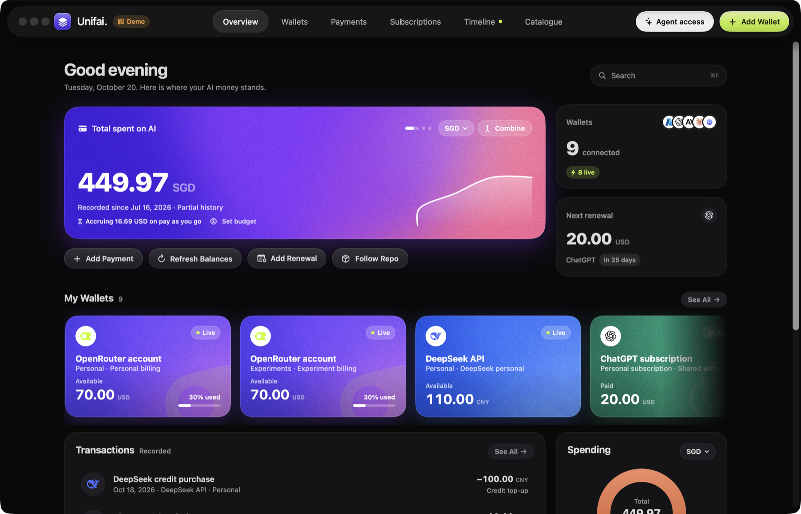
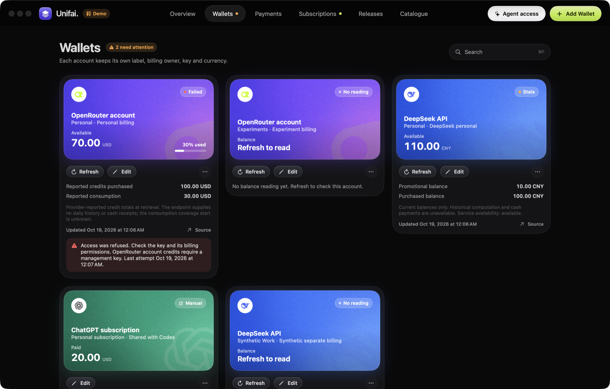
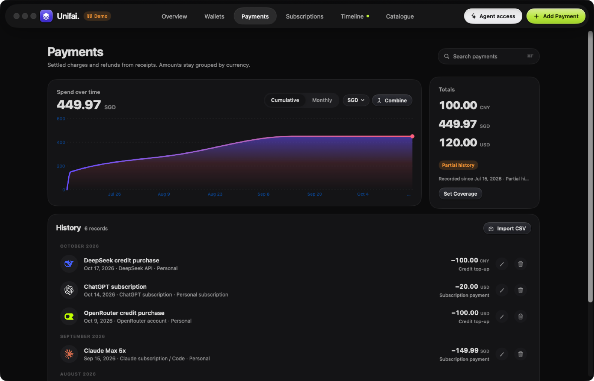
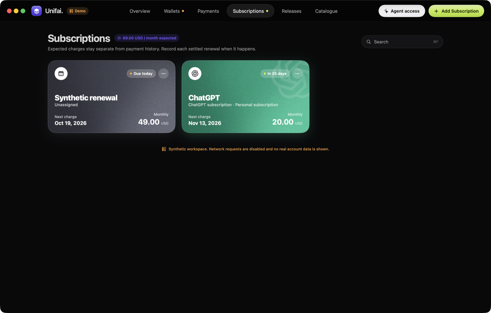
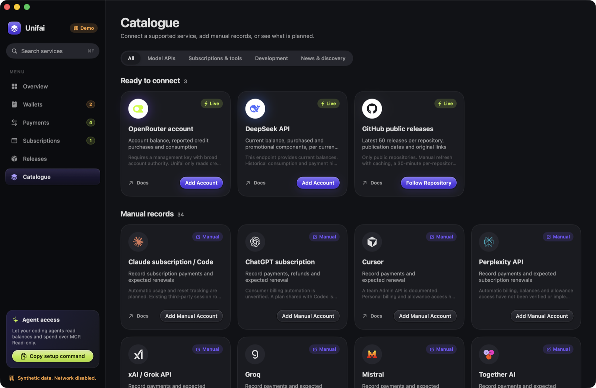

# Unifai

Unifai is a local macOS app that shows where your AI money stands: remaining credit across provider wallets, what you have actually paid, upcoming subscription renewals, and new releases from the projects you follow. It also ships a read-only MCP server, so your coding agents can ask the same questions.



- **Wallets** for OpenRouter and DeepSeek read live balances with keys stored in macOS Keychain. Any other provider can be tracked as a manual account.
- **Payments** keeps a currency-preserving ledger of top-ups, subscription charges and refunds, with spend charts.
- **Subscriptions** tracks expected renewals separately from money actually paid.
- **Releases** follows public GitHub repositories without signing in.
- **Agent access** exposes balances, spend and renewals to Claude Code, Codex, Cursor or any MCP client, read-only.

Everything stays on your Mac. There is no account, server or sync. The first native milestone was verified on 2026-10-19; [verification evidence](evidence/VERIFICATION.md) records the checks and their limits.

| Wallets | Payments |
| --- | --- |
|  |  |
| **Subscriptions** | **Catalogue** |
|  |  |

Screenshots use the synthetic demo workspace described below; no real account data is shown.

## Install

Install the signed, notarized app with Homebrew:

```sh
brew install --cask kennykankush/tap/unifai
```

Update with `brew upgrade --cask unifai`. The cask also links `unifai-mcp` onto your PATH. Releases are built for Apple silicon and need macOS 14 or later.

## Develop locally

Use a Mac with Xcode and Swift installed. This checkout was built with Swift 6.2 and Xcode 26.0.1 on macOS 26.5, Apple silicon. The deployment target is macOS 14; an actual macOS 14 machine has not been tested.

Build the local development app and open it:

```sh
git clone https://github.com/kennykankush/Unifai.git
cd Unifai
bash scripts/build-app.sh
open ".build/Unifai Dev.app"
```

**Unifai Dev** is a separate app from the official **Unifai**. It shows a Dev tag, stores data in `~/Library/Application Support/Unifai Dev` and uses its own Keychain service, so you can run a development build next to the Homebrew install without either touching the other's accounts or records.

The build uses no package dependencies and applies a local ad-hoc signature. It requires no Apple developer account.

The window opens on **Overview** with an empty state. Click **Add Wallet**, or open **Catalogue** in the top bar, to add an account. The top bar switches between Overview, Wallets, Payments, Subscriptions, Releases and Catalogue, and its lime button runs the current page's main action. A dot marks Wallets when a reading failed or went stale, and Subscriptions when a renewal is due within a week. Press Command-F to search the current page and Command-N for the main action. Use the menu bar stack icon for the companion. **File > Show Companion** opens the same panel; **File > Show Unifai** returns to the main window. Closing the window keeps the companion running. Quit from the app menu or companion.

## Connect accounts and record money

Each account has its own label, billing owner and Keychain item. Add personal and work accounts separately. Connect a billing owner once; replace its key through **Edit Account** when needed. Matching labels or emails do not establish whether two accounts share billing.

| Connection | Working coverage | Required setup and limits |
| --- | --- | --- |
| OpenRouter account | Remaining USD credit, reported purchased credits and consumption | Enter a management key, then click Refresh. This key has broad authority; the app only sends the credits GET request. Credit totals do not establish cash receipts or daily history. |
| DeepSeek API | Current balances and purchased/promotional components, preserving currency | Enter an API key, then click Refresh. This endpoint supplies no payment or consumption history. |
| Manual financial accounts | Payments, refunds and expected renewals | Add confirmed records from receipts. Automatic balances and allowances remain unavailable. |
| Public GitHub releases | Latest 50 published releases, original links, optional prereleases | Add `owner/repository`, then click Refresh. No credential is accepted or needed. |

The catalogue separates implemented connectors, manual records and planned capabilities. Planned financial services offer **Add Manual Account**. Planned news sources have no connection action. Claude API, Claude subscriptions, Codex allowances and OpenAI API billing remain separate entries.

In **Payments**, record settled charges using a positive amount and an ISO currency code such as USD or CNY. Choose **Refund** to reduce the paid total. A receipt reference detects duplicates within the same account. Edit or remove records through their row controls; removals require confirmation.

In **Subscriptions**, save an expected amount, cadence and renewal date. A schedule creates no payments. After a renewal settles, choose **Record Settled Payment**, confirm the receipt, and update the next expected date. A ChatGPT plan shared with Codex should be recorded once.

Money paid, provider-reported consumption, remaining credit and expected renewals stay separate. A USD 100 top-up followed by USD 30 of consumption is USD 100 paid and USD 70 remaining. Currencies are never combined. Payment history shows its start and whether you have confirmed completeness for that period; it does not claim a lifetime total from a current balance.

## Let agents read your balances (MCP)

`unifai-mcp` is a read-only MCP server over stdio. Any MCP client, such as Claude Code, Codex or Cursor, can use it to answer "how much credit do I have left?" from the same data the app shows.

With the Homebrew install, the server ships inside the app:

```sh
claude mcp add --scope user unifai -- /Applications/Unifai.app/Contents/MacOS/unifai-mcp
```

The white **Agent access** button in the app's top bar copies the exact setup line for whichever app you are running. Development builds register as `unifai-dev` and point at the Unifai Dev data folder. To build only the server from source, run `bash scripts/build-mcp.sh`.

| Tool | Returns |
| --- | --- |
| `get_overview` | Remaining credit per account, money paid per currency, renewals due within 30 days, and accounts with stale or failed readings |
| `get_balances` | Per-account credit remaining, purchased/promotional components, reported consumption, observation time and staleness. Optional `provider` filter |
| `get_spending` | Recorded payments and refunds with per-currency totals and coverage. Optional `since` (YYYY-MM-DD) and `limit` |
| `get_renewals` | Expected renewals with amount, cadence and days until due. Optional `within_days` |

The server re-reads `state.json` on every call. It never opens Keychain, never sends network requests and never writes. Balances are as fresh as the last **Refresh** in the app; each reading carries `observedAt` and `stale`. Amounts are decimal strings with their currency, and no measure is summed across currencies or across credit, payments and renewals.

To use a different data directory, pass `--data-directory <path>` or set `UNIFAI_DATA_DIR`. For example, to try the server against synthetic data, run `.build/release/unifai-mcp --data-directory .qa/fixture-workspace`.

## Refresh and storage behavior

Refreshes are manual. Balance refreshes have a one-minute per-account cooldown. Failed refreshes preserve the previous reading and show the error; balance readings become stale after one hour.

GitHub uses one conditional request per refresh, at most 10 repositories, a 30-minute cooldown per repository, and a persisted budget of 20 requests per hour across the watchlist. Cooldowns apply to failures too. Server rate-limit backoff applies across repositories and survives relaunch. Other apps may use the same originating IP limit.

Normal data lives in `~/Library/Application Support/Unifai/state.json`. The file contains account metadata, readings, payment records, schedules and release caches, with mode `0600`. Credentials live separately in macOS Keychain, scoped by Unifai service and account UUID. The app does not enumerate other credentials, inspect browser sessions, or import local tool accounts.

Quit Unifai before copying `state.json` for a backup. This file is local JSON, not encrypted storage. A JSON backup does not include Keychain credentials; enter replacement keys after moving to another Mac. If loading fails or the schema is newer, Unifai preserves the file and disables writes. Restore a valid backup and restart. Run one normal app process per data directory.

## Try the synthetic workspace

Use this separate app to explore without provider credentials:

```sh
bash scripts/run-fixture.sh
```

**Unifai Fixtures** displays a persistent synthetic-data banner and disables all network transports. It stores records in `.qa/fixture-workspace`, uses in-memory account keys, and preserves edits across relaunch. Each launch also checks Keychain with newly created synthetic items in a unique test service, removes them, and writes `native-keychain-check.json` in the fixture directory.

Refresh its OpenRouter and DeepSeek accounts to see sample readings. In a fixture account’s **Edit Account** form, replace the key with `fixture-unauthorized` or `fixture-offline` to inspect failures. These strings are test selectors, not provider credentials. Fixture keys reset to valid synthetic values on relaunch; saved readings and errors remain until refreshed.

## Run the checks

Run the offline suite; the two explicit integration checks are skipped by default:

```sh
bash scripts/swift-local.sh test
```

Opt in to the synthetic Keychain check and one anonymous public request to `swiftlang/swift`:

```sh
UNIFAI_TEST_KEYCHAIN=1 UNIFAI_TEST_PUBLIC_GITHUB=1 \
  bash scripts/swift-local.sh test
```

The offline suite currently runs 35 tests, with the two integration checks skipped. An earlier witnessed full run, with both integration checks enabled, passed 32 tests with no failures or skips. It retrieved 50 public GitHub releases in one request. Debug and optimized builds passed. [Native checks](evidence/VERIFICATION.md) covered empty state, account setup, both fixture balances, retained error readings, payments, schedules, catalogue search, releases, resizing and the companion.

## Release

Official releases come from `scripts/release.sh` on the release Mac. It runs the tests, builds an optimized app, signs the app and the embedded `unifai-mcp` with a Developer ID certificate and hardened runtime, notarizes and staples it, tags `v<VERSION>`, uploads the zip to GitHub Releases, and updates the cask in [kennykankush/homebrew-tap](https://github.com/kennykankush/homebrew-tap).

```sh
# once: save notarization credentials (app-specific password from account.apple.com)
xcrun notarytool store-credentials unifai --apple-id <apple id> --team-id <team id>

# each release: bump VERSION, commit and push main, then
bash scripts/release.sh
```

`bash scripts/release.sh --dry-run` builds, signs and verifies locally without notarizing or publishing.

## Remaining limits

OpenRouter and DeepSeek have contract, parsing and failure-path validation with synthetic fixtures. Authentication against real provider accounts remains unverified until keys are entered. No paid provider or news request was made during development.

WidgetKit, quota/reset tracking, Claude/OpenAI organization reporting, invoice imports, RSS, X, richer discovery, notifications and sync remain deferred. X access is disabled. Renewal advancement is manual. Light appearance, VoiceOver operation and macOS 14 hardware have not received hands-on verification. Releases are Apple silicon only.

## Credits

Provider logos come from [LobeHub Icons](https://github.com/lobehub/lobe-icons) (MIT License, included at `Sources/Unifai/Resources/Logos/LICENSE`). Logos and product names are trademarks of their respective owners and are used only to identify each service.

[VISION.md](VISION.md) preserves the original intent and raw quotes unchanged. [DEVELOPMENT.md](DEVELOPMENT.md) describes the implementation and current status.
